<div align="center">

<!-- Banner animado -->


<!-- Nome em rosa neon (arquivo neon-name.svg na raiz do repositório) -->


<!-- Texto digitando -->
<a href="https://github.com/MariaEduardaCiarini">
  
</a>

<br/><br/>


<br/><br/>

<a href="https://www.linkedin.com/in/maria-eduarda-ciarini/">
  
</a>
<a href="mailto:mariaeduardaciarini@gmail.com">
  
</a>
<a href="https://github.com/MariaEduardaCiarini">
  
</a>

<br/><br/>


</div>


<details open>
<summary><b>⚡ SOBRE_MIM.exe</b> <i>(clique para abrir/fechar)</i></summary>

<br/>

```bash
┌──(maria㉿dev)-[~/sobre]
└─$ whoami
   Maria Eduarda Ciarini · Dev Jr & Suporte Técnico

┌──(maria㉿dev)-[~/sobre]
└─$ cat formacao.txt
   Análise e Desenvolvimento de Sistemas · FIAP (2023–2025)

┌──(maria㉿dev)-[~/sobre]
└─$ cat foco.txt
   Python + Java · Front-End · APIs REST · Bancos de Dados

┌──(maria㉿dev)-[~/sobre]
└─$ ./status --now
   [■■■■■■■■□□] Aprofundando AWS Cloud e Docker
   [■■■■■■■■■□] Construindo soluções práticas todos os dias
   [■■■■■■■■■■] Aberta para novos projetos
```

> 💬 Pergunte-me sobre **Back-End, Front-End, APIs REST e Bancos de Dados**
> 📫 Como me encontrar: veja os badges acima

</details>


## 🛰️ `./stack --list`

<details open>
<summary><b>💻 Linguagens & Frameworks</b></summary>

<br/>

<p align="center">
  
</p>

<p align="center">
  
  
  
  
  
</p>

</details>

<details>
<summary><b>☁️ Cloud & DevOps</b></summary>

<br/>

<p align="center">
  
</p>

<p align="center">
  
</p>

</details>

<details>
<summary><b>🗄️ Bancos de Dados</b></summary>

<br/>

<p align="center">
  
  
  
  
  
</p>

</details>

<details>
<summary><b>🖥️ Sistemas Operacionais</b></summary>

<br/>

<p align="center">
  
  
  
</p>

</details>


## 📡 `./github --stats`

<div align="center">


<br/>


<br/>


</div>

<!--
  OPCIONAL: cobrinha comendo os commits 🐍
  Requer o workflow "Platane/snk" no repositório (gera dist/github-snake-dark.svg).
  Depois, descomente a linha abaixo:

  
-->


<div align="center">

```bash
$ echo "Presto serviços como desenvolvedora júnior e em suporte técnico — estou aberta para ajudar."
```


</div>
